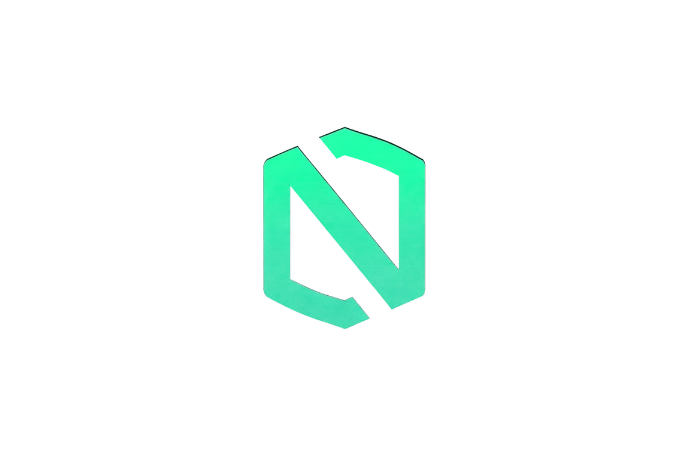

<p align="center"></p>

# nearsc

**Deterministic security scanner for NEAR smart contracts: a CLI, an MCP server
for coding agents, and a knowledge base of real NEAR audit precedent.**

[](https://github.com/vinibarbosabr/nearsc-auditor/actions/workflows/ci.yml)
[](https://github.com/vinibarbosabr/nearsc-auditor/actions/workflows/self-scan.yml)
[](https://crates.io/crates/nearsc)
[](LICENSE)

## What it does

- **Scans NEAR contract Rust source** with 13 rules (NS001-NS013): callback
  privacy, 1-yocto authorization, unchecked promise results, unguarded
  init/upgrade paths, unbounded iteration, storage griefing, insecure
  randomness, arbitrary promise targets, deposit-refund gaps, privileged
  setters, repeatable balance drains. Reports text, JSON, SARIF 2.1, or a
  self-contained HTML page.
- **Serves coding agents over MCP**: five read-only tools (scan, pattern
  lookup, audit precedent, on-chain contract reputation, PoC scaffold) with
  path confinement and account-id validation.
- **Ships an embedded knowledge base**: 15 NEAR vulnerability pattern classes,
  7 audit entries, 2 postmortems, and a 3-entry audited-build registry, each
  sourced, linked, and confidence-labeled.

The scan path is offline, deterministic, and never executes scanned code: no
LLM calls, no network, byte-stable output for the same input on any machine.

## Try it in 60 seconds

```bash
git clone https://github.com/vinibarbosabr/nearsc-auditor
cd nearsc-auditor
cargo run -p nearsc -- scan examples/vulnerable-contract
```

Expected output (captured 2026-11-12 from this tree):

```text
HIGH     NS001 src/lib.rs:58 transfer method `ft_transfer` does not enforce the 1-yoctoNEAR attached deposit; add assert_one_yocto() or an equivalent check (NEP-141/171)
MEDIUM   NS012 src/lib.rs:82 public setter `set_owner` changes privileged state or moves funds without a guard; restrict it with #[private] or assert predecessor == owner/current_account_id
HIGH     NS002 src/lib.rs:87 callback `on_deposit_complete` can be invoked by any account; add #[private] or assert predecessor == current_account_id
MEDIUM   NS003 src/lib.rs:95 callback `on_withdraw_result` can panic on attacker-influenced input; handle failure explicitly instead of unwrap/expect/indexing
HIGH     NS004 src/lib.rs:111 function `on_deposit_result` consumes a promise result without matching PromiseResult::Failed; state can advance on a failed cross-contract call
CRITICAL NS006 src/lib.rs:119 function `set_state` writes contract state without an access-control guard; a caller can overwrite it. Add #[private] or assert predecessor == current_account_id / owner
LOW      NS011 src/lib.rs:137 payable method `claim` can return early after the deposit attached and shows no refund path; refund the attached deposit on every early exit or document why funds may stay
MEDIUM   NS009 src/lib.rs:145 `draw_winner` derives a value from block data or the caller's account; those inputs are predictable or influenceable, so lotteries/mints built on them can be steered. Use a commit-reveal or a random-seed oracle
MEDIUM   NS008 src/lib.rs:153 public method `free_note` stores caller-controlled data without an attached deposit or storage check; charging for storage (or requiring it up front) keeps the contract's balance from being drained
MEDIUM   NS007 src/lib.rs:159 public method `total_pending` loops over a collection that callers can grow without a bound; add pagination or cap the iteration before gas makes this method uncallable
HIGH     NS010 src/lib.rs:166 public method `notify_receiver` builds a Promise::new target from caller input without an allowlist check; restrict targets to state-derived values or an allowlist before the contract pays or calls attacker-chosen accounts
CRITICAL NS005 src/lib.rs:182 ignore_state init `migrate` is not access-controlled; any account can reinitialize contract state. Add #[private] or assert predecessor == current_account_id
12 findings (critical 2, high 4, medium 5, low 1, info 0)
disclaimer: 10 of 12 findings are heuristic-confidence review hints; expect false positives and confirm each one by hand
```
The patched twin of the example scans clean:

```text
$ cargo run -p nearsc -- scan examples/fixed-contract
0 findings (critical 0, high 0, medium 0, low 0, info 0)
```

After installing (see below), the same scan is `nearsc scan examples/vulnerable-contract`.
Other formats:

```bash
nearsc scan examples/vulnerable-contract --format json    # machine-readable envelope
nearsc scan examples/vulnerable-contract --format sarif   # SARIF 2.1 for code scanning
nearsc scan examples/vulnerable-contract --format html --output report.html
nearsc scan examples/vulnerable-contract --fail-on high   # CI gate: exit 1 on high+
```

## Install

```bash
cargo install nearsc        # CLI + library
cargo install nearsc-mcp    # MCP server for coding agents
```

Prebuilt binaries for linux x86_64/aarch64 and macOS x86_64/aarch64 are
attached to each [GitHub release](https://github.com/vinibarbosabr/nearsc-auditor/releases)
with SHA-256 checksums. From source:

```bash
git clone https://github.com/vinibarbosabr/nearsc-auditor
cd nearsc-auditor
cargo install --path crates/nearsc --locked
```

## Use as an MCP server

```bash
cargo install nearsc-mcp   # stdio server
```

opencode (`opencode.json` in the project you want audited):

```json
{ "mcp": { "nearsc": { "type": "local", "command": ["nearsc-mcp"], "enabled": true } } }
```

Claude Code:

```bash
claude mcp add nearsc -- nearsc-mcp
```

Other harnesses (Cursor, Claude Desktop) accept the generic `mcpServers`
command+args shape; snippets are examples, check your harness docs. Five
read-only tools: `nearsc_scan`, `nearsc_patterns`, `nearsc_audits`,
`nearsc_contract_info`, `nearsc_poc_scaffold`. Path-taking tools are confined
to the project the harness opened. Full contract: [docs/MCP.md](docs/MCP.md).
Safety model: [docs/SECURITY.md](docs/SECURITY.md).

## Use as an agent skill

Point your harness at [`nearsc-skill/SKILL.md`](nearsc-skill/SKILL.md) (opencode/Claude-compatible frontmatter). It carries the audit workflow: Recon → Scan → Verify → Report, NEAR context, and the safety rules.

## GitHub Action

```yaml
- uses: vinibarbosabr/nearsc-auditor/action@v0.1.2
  with:
    path: ./contracts
    fail-on: high
```

Uploads nothing by itself; pair it with `github/codeql-action/upload-sarif` using the `sarif` output (see [.github/workflows/self-scan.yml](.github/workflows/self-scan.yml) for a full example). The action dogfoods itself on every push: the repository's own Security → Code scanning page shows the SARIF results for `examples/vulnerable-contract`.

## Rules

| ID | Rule | Severity | Confidence |
| --- | --- | --- | --- |
| NS001 | one-yocto-missing-on-transfer | high | spec |
| NS002 | callback-not-private | high | spec |
| NS003 | callback-panic-risk | medium | heuristic |
| NS004 | unchecked-promise-result | high | heuristic |
| NS005 | init-ignore-state-unguarded | critical | heuristic |
| NS006 | upgrade-path-unguarded | critical | heuristic |
| NS007 | unbounded-iteration | medium | heuristic |
| NS008 | storage-griefing | medium | heuristic |
| NS009 | insecure-randomness | medium | heuristic |
| NS010 | arbitrary-promise-target | high | heuristic |
| NS011 | deposit-refund-missing | low | heuristic |
| NS012 | privileged-setter-unguarded | medium | heuristic |
| NS013 | balance-drain-transfer | high | heuristic |

Detection prose, false-positive notes, and vulnerable/fixed pairs per rule: [docs/RULES.md](docs/RULES.md). Run `nearsc rules list` / `nearsc rules show NS002` for the catalog from the binary. Every rule ships a vulnerable + patched fixture pair (`tests/fixtures/`) as the test oracle.

## Knowledge base

Embedded in the binary (no network, no data directory needed): 15 vulnerability
pattern classes with audit-precedent links, 7 public audit entries, 2
postmortems (Potlock/Guvenkaya 2024, NEAR Intents 2025 - the latter in a
classified per-finding format), and a 3-entry audited-build registry keyed by
on-chain code hash. Every entry carries its source URL, retrieval date, and a
confidence label (`verified-public` / `community` / `inferred`). Schema,
sourcing rules, and the entry list: [docs/KNOWLEDGE-BASE.md](docs/KNOWLEDGE-BASE.md).

## Architecture

```
nearsc-auditor/
├── crates/
│   ├── nearsc/          # lib + bin: engine, 13 rule matchers, reports, RPC, embedded KB
│   └── nearsc-mcp/      # rmcp stdio server, 5 tools, same engine
├── tests/fixtures/      # vuln.rs + fixed.rs per rule (the test oracle)
├── examples/vulnerable-contract/   # deliberately vulnerable demo contract
├── nearsc-skill/SKILL.md # agent skill (Recon → Scan → Verify → Report)
├── action/              # composite GitHub Action
├── docs/                # design docs: rules, MCP, KB, security, demo
└── .github/workflows/   # ci.yml, self-scan.yml, release.yml
```

Pipeline: walk `*.rs` → `syn::parse_file` → per-file context (fns, attrs, trait impls) → rule matchers → sorted findings → report. Parse failures are recorded as info findings, never fatal. Full design: [docs/ARCHITECTURE.md](docs/ARCHITECTURE.md).

## Baseline and hackathon work

Per hackathon rules Q-003/Q-005: the [`pre-hackathon`](https://github.com/vinibarbosabr/nearsc-auditor/tree/pre-hackathon) tag marks the v1 prompt-stack baseline (June-July 2026). Everything above it on `feat/hackathon` is new work built during the NEAR Hackathon 2026 window (Nov 9-14, 2026) with AI coding agents as baseline-allowed tooling (design decisions in [docs/DESIGN-DECISIONS.md](docs/DESIGN-DECISIONS.md)). The in-window diff: [`pre-hackathon...v0.1.2`](https://github.com/vinibarbosabr/nearsc-auditor/compare/pre-hackathon...v0.1.2). Tag `hackathon-submission` marks the exact state submitted to the hackathon (pushed before the submission POST on Nov 14).

Process: built with agent-assisted audits; findings and their fixes are tracked as issues labeled [audit-finding](https://github.com/vinibarbosabr/nearsc-auditor/issues?q=label%3Aaudit-finding). How false positives are handled — classify, disclose, fix conservatively, never trade recall for quiet output — is codified in [docs/FALSE-POSITIVES.md](docs/FALSE-POSITIVES.md); community FP reports use the false-positive issue template.

## Security and limits

Static analysis is not a substitute for a manual audit: findings are review
signals, and heuristic rules can produce false positives (per-rule notes in
[docs/RULES.md](docs/RULES.md)). The scanner parses, never executes, scanned
code; the MCP server treats scanned repositories and knowledge-base text as
data and instructs agents to ignore instructions found inside them. Threat
model and limits: [docs/SECURITY.md](docs/SECURITY.md).

## License, contributing, roadmap

MIT. See [LICENSE](LICENSE). Contributions: [docs/CONTRIBUTING.md](docs/CONTRIBUTING.md) (add a rule, add a KB entry, dev setup). What's next: [docs/ROADMAP.md](docs/ROADMAP.md). The official hackathon rules file is kept at [HACKATHON.md](HACKATHON.md); the v1 prompt stack is preserved under `legacy/` per Q-003.
